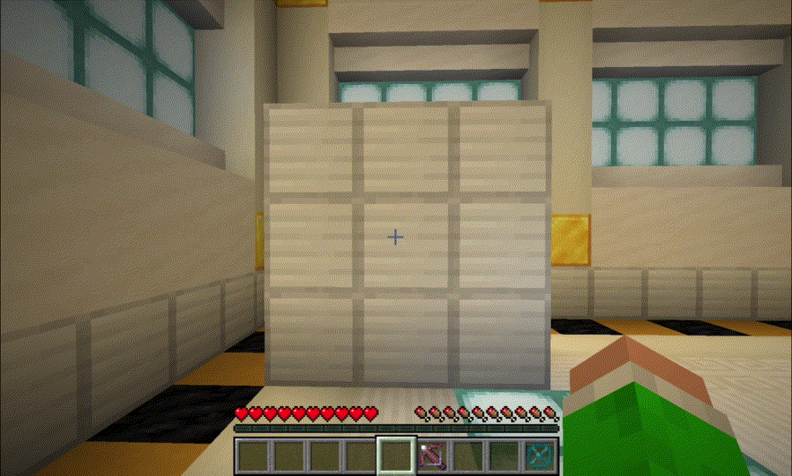
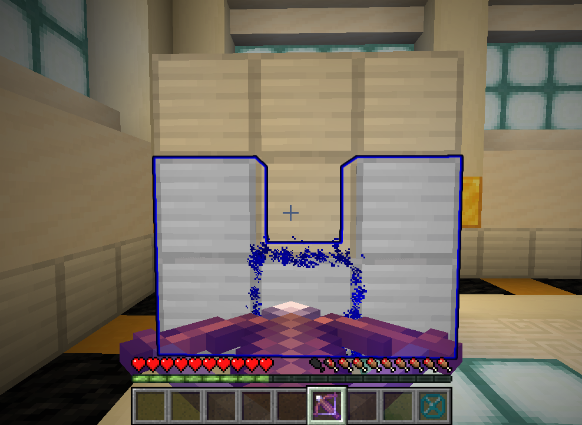

# Redstone⁴'s 𝓕𝓪𝓷𝓬𝔂 𝓓𝓸𝓸𝓻𝓼

This datapack adds tools for building smooth-moving doors using block displays.




# Configuration

Additional configuration options are available with:
```
/function fdoors:configure
```

This menu allows an operator to toggle:
* Allowing barrier blocks, bedrock, and block entities in doors
* Hiding the first-time welcome message
* Toggling between an operator-only and a non-operator door configuration dialog

To disable recipes for the door controller and block selector, delete the `FancyDoors/data/fdoors_survival` folder from the pack.


# Usage Guide

## Getting Started

Currently, the door controller and block selector are only obtainable with cheats:
```
/function fdoors:give
```

## Creating Doors

To create a new door, place the door controller onto a surface.  Then, left-click the block selector onto the door controller to pair with the controller.

Once paired, fire arrows with the block selector to add or remove blocks from the door:




## Configuring Doors

Left-click on the door controller with the block selector a second time to open the door configuration dialog:


### Triggers

The trigger determines the condition required for the door to open.  Currently, there are four triggers:

* **Range**: Door opens when a player is within range of the controller
* **Item match**: Door opens when a player within range of the controller is holding a specific item in their main hand
* **Block match**: Door opens when the block at the controller's position matches a specific state
* **Predicate**: Door opens when the given predicate passes.  Inline predicates are not accepted due to limitations with dialogs and function macros.

### Transformations

Transformations determine the final position of the door once it's fully opened:

* **Offset**: The final x/y/z offset of the entire door when opened
* **Scale**: The final x/y/z scale of the individual block displays
* **Yaw**: The yaw-rotation applied to the entire door
* **Pitch**: The pitch-rotation applied to the entire door

### Sound Effects

Doors play sound effects when they:

* Start opening
* Finish opening
* Start closing
* Finish closing

The name, volume and pitch of these sounds can be configured separately.


### Outline Color

"Outline color" sets the glow color and particle color used in the door preview.  This is useful when multiple doors are directly next to each other and need to be distinguished.
