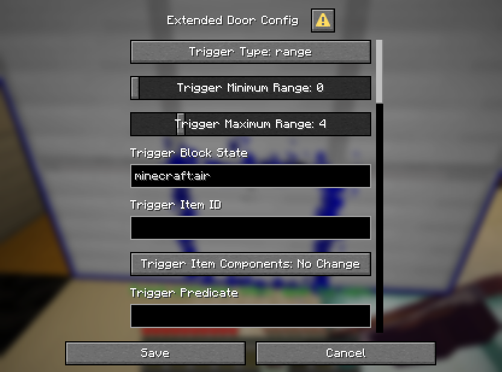

# Redstone⁴'s 𝓕𝓪𝓷𝓬𝔂 𝓓𝓸𝓸𝓻𝓼

This datapack adds tools for building smooth-moving doors using block displays.


# Configuration

Additional configuration options are available with:
```
/function fdoors:configure
```

This menu allows an operator to toggle:
* Allowing barrier blocks, bedrock, and block entities in doors
* Hiding the first-time welcome message
* Toggling between an operator-only and a non-operator door configuration dialog


# Usage Guide

## Getting Started

Currently, the door controller and block selector are only obtainable with cheats:
```
/function fdoors:give
```

## Creating Doors

To create a new door, place the door controller onto a surface.  Then, left-click the block selector onto the door controller to pair with the controller.

Once paired, fire arrows with the block selector to add or remove blocks from the door:


## Configuring Doors

Left-click on the door controller with the block selector a second time to open the door configuration dialog:



### Triggers

The trigger determines the condition required for the door to open.  Currently, there are four triggers:

* **Range**: Door opens when a player is within range of the controller
* **Item match**: Door opens when a player within range of the controller is holding a specific item in their main hand
* **Block match**: Door opens when the block at the controller's position matches a specific state
* **Predicate**: Door opens when the given predicate passes.  Inline predicates are not accepted due to limitations with dialogs and function macros.

### Transformations

Transformations determine the final position of the door once it's fully opened:

* **Offset**: The final x/y/z offset of the entire door when opened
* **Scale**: The final x/y/z scale of the individual block displays
* **Yaw**: The yaw-rotation applied to the entire door
* **Pitch**: The pitch-rotation applied to the entire door

### Sound Effects

Doors play sound effects when they:

* Start opening
* Finish opening
* Start closing
* Finish closing

The name, volume and pitch of these sounds can be configured separately.


### Outline Color

"Outline color" sets the glow color and particle color used in the door preview.  This is useful when multiple doors are directly next to each other and need to be distinguished.


# Insane Technical Jargon

Doors use a single marker with the `fdoors.door.base` tag as their root entity.  Their configuration data is stored under the marker entity's `data` tag in the following format:
```
{
    duration: <int: number of ticks animation should take>
    transform: {
        translation: [
            <float: x-translation of opened door>,
            <float: y-translation of opened door>,
            <float: z-translation of opened door>,
        ],
        scale: [
            <float: x-scale of block displays when door is opened>,
            <float: y-scale of block displays when door is opened>,
            <float: z-scale of block displays when door is opened>,
        ],
        pitch: <float: yaw-rotation of opened door>,
        yaw: <float: yaw-rotation of opened door>
    },
    trigger: {
        type: <str: Type of trigger, may be either range, block, item, or predicate>,
        args: {
            min: <float: Lower bound of activation range.  Only applies when trigger type is "range" or "item">,
            max: <float: Upper bound of activation range.  Only applies when trigger type is "range" or "item">,
            item: {   # Only present when trigger type is "item"
                id: <str: item ID that a player within range must hold.  Only applies when trigger type is "item">,
                components: <NBT tag: custom item components that the player must be holding.  Only applies when trigger type is "item".  Optional.>
            },
            predicate: <str: Name of predicate resource.  Only applies when trigger type is "predicate">
        }
    },
    sounds: {
        start_open: {
            sound: <str: Sound ID to play when door starts to open>,
            pitch: <float: Pitch of sound passed to /playsound>,
            volume: <float: Volume of sound passed to /playsound>
        },
        finish_open: {
            sound: <str: Sound ID to play when door finishes opening>,
            pitch: <float: Pitch of sound passed to /playsound>,
            volume: <float: Volume of sound passed to /playsound>
        },
        start_close: {
            sound: <str: Sound ID to play when door starts to close>,
            pitch: <float: Pitch of sound passed to /playsound>,
            volume: <float: Volume of sound passed to /playsound>
        },
        finish_close: {
            sound: <str: Sound ID to play when door finishes closing>,
            pitch: <float: Pitch of sound passed to /playsound>,
            volume: <float: Volume of sound passed to /playsound>
        }
    },
    blocks: [
        {
            x: <int: x-offset of block from door controller>,
            y: <int: y-offset of block from door controller>,
            z: <int: z-offset of block from door controller>,
            id: <str: ID of this block>,
            properties: <NBT tag: Block state properties>,
            state_string: <str: Block state properties compatible with /setblock>
        },
        ...
    ],
    color: {
        r: <float: red channel of outline color>,
        g: <float: green channel of outline color>,
        b: <float: blue channel of outline color>
    },
    glow_color: <int: base-10 representation of hexidecimal color code for the preview outline, set automatically from color>,
    owner_uuid: <UUID: UUID of door's owner>
}

```

Additional block displays are summoned with the `fdoors.door.visual_block` tag when the door opens or is being configured.

